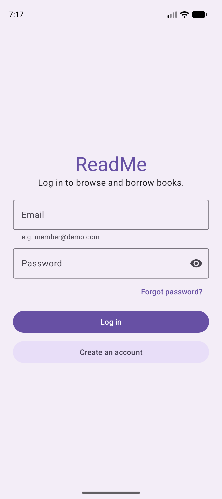
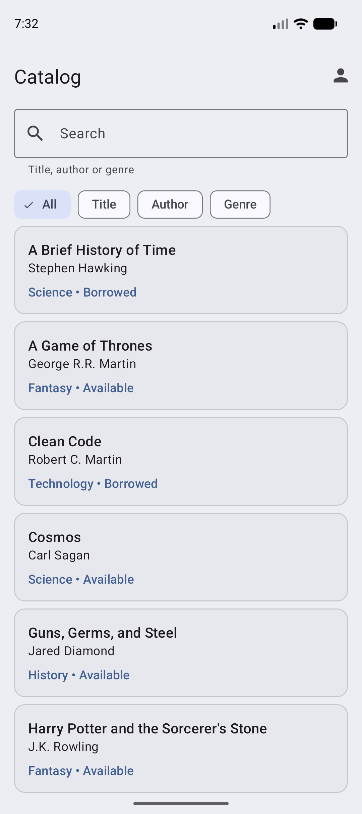
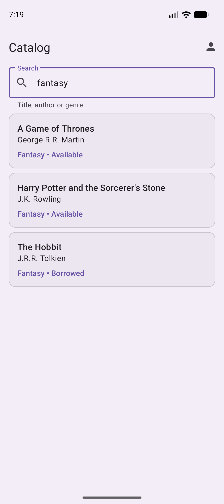
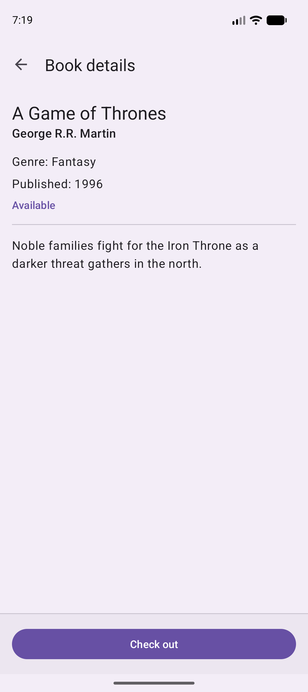
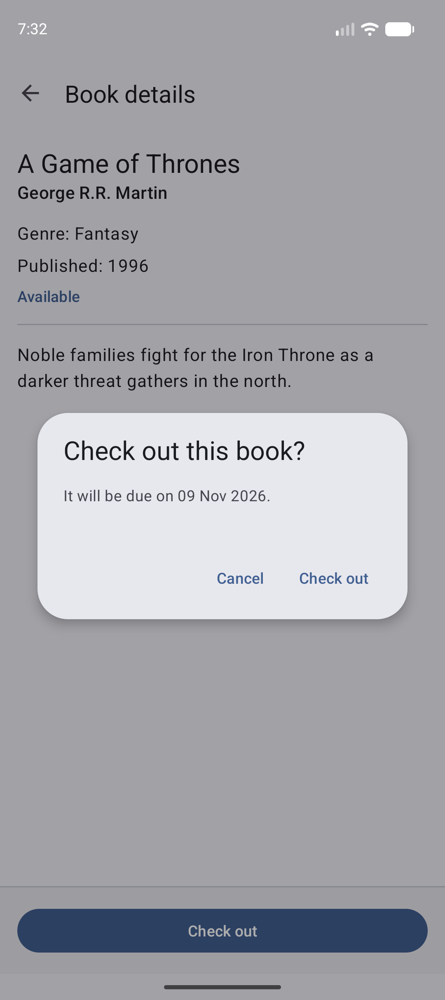
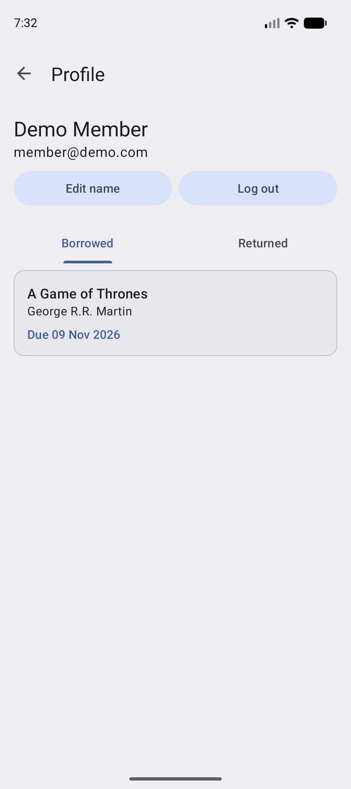

# ReadMe

An Android library app where members browse the catalog, search it, check out available books and return them. It is a fully simulated demo: no backend, no payment gateway, no email or SMS and no real push notifications.

**Core flow:** Sign up / Log in → Browse or search the catalog → Book details → Check out → Return from Profile

## About

ReadMe is a practice project built in preparation for the Tagisan ng Talino 2026 - 2027 Code Fest hackathon. It is based on the STI College Balayan Codefest Training AY 2023-2024, Problem #3: Library App. The whole app works offline: the catalog and book details are seeded into SQLite and never fetched.

| | |
|---|---|
| Team Name | ERRAnds |
| Team Members | [Vrixzandro Eliponga](https://github.com/mowtiie), [Michael Tagle](https://github.com/ImmunoCapacity), [Christine Jane Lapuz](https://github.com/chrstnjn) |

## Features

**Registration and authentication**
- Sign up with name, email, password and confirm password. Email must be unique and valid, password is 6+ characters
- Log in by email and password, and reset a forgotten password by email and a new password (no email is sent)
- Errors show inline on the field that is wrong

**Book catalog**
- 15 seeded books across 5 genres: Fiction, Fantasy, Science, History and Technology
- Each row shows title, author, genre and whether the book is Available or Borrowed, sorted by title
- Tap a row to open Book details

**Search**
- A search field above the list re-queries on every keystroke, with no search button
- Filter chips under the field choose what to search: All (default), Title, Author or Genre. Matching ignores case, and no matches shows an empty view

**Book details**
- Title, author, genre, summary, publication date and availability
- One button in the bottom bar: **Check out** for an available book, a disabled **Unavailable** when someone else has it, and **Return** when you hold it

**Checkout and return**
- The status is re-read from the database when you tap Check out. If the book was taken meanwhile you get a message and the screen refreshes
- A confirm dialog shows the due date (14 days from today) before the loan is created
- Checkout and return each update the book and its loan in one database transaction
- No fines, no renewals and no borrowing limit
- Return from Book details, or from the Borrowed tab on Profile

**Profile**
- Shows your name and email, with Edit name (in a bottom sheet) and Log out
- **Borrowed** tab: books not yet returned, with due date. Tap a row to return it
- **Returned** tab: history with borrowed and returned dates

## Tech specs

| | |
|---|---|
| Language | Java 11 |
| UI | XML layouts, Material Design 3 (Material Components 1.14), view binding |
| Min / target SDK | 24 (Android 7.0) / 36 |
| Build | Android Gradle Plugin 9.2.1, Gradle 9.4.1 |
| Storage | Local SQLite for users, books and loans |
| Theme | Material Theme Builder palette with light and dark mode |
| Navigation | One Activity per screen, no fragments |
| Libraries | AndroidX AppCompat, Activity, ConstraintLayout and Material Components only |

## Requirements

- Android Studio (a recent version that supports AGP 9.x) and JDK 11 or newer
- An Android emulator or device running Android 7.0 (API 24) or higher

## Getting started

```bash
git clone https://github.com/mowtiie/ReadMe.git
cd ReadMe
./gradlew assembleDebug
```

Then open the project in Android Studio and press **Run** on an emulator. The debug APK is created at `app/build/outputs/apk/debug/`.

## Demo accounts

Both accounts use the password `demo1234`.

| User | Email | Books |
|---|---|---|
| Demo Member | `member@demo.com` | None borrowed |
| Alex Reyes | `alex@demo.com` | The Hobbit, A Brief History of Time, Clean Code |

Log in as the Demo Member and open a book to check it out, then return it from Details or from Profile. Alex's three books show as Borrowed in the catalog and cannot be checked out. The demo data is seeded when the database is first created, so no screen starts out empty.

## What is simulated

- Sign up, login, logout, profile edit and password reset are fake but validated.
- Due dates are shown for information only. Nothing happens when a loan is overdue.
- Messages are Toasts, Snackbars and lists inside the app. There are no real Android notifications.
- Data is saved in local SQLite and persists across restarts. Only the logged-in user is kept in memory, so closing the app logs you out.

## Screenshots

<div align="center">
	<div>
         
         
         
         
         
         
	</div>
</div>

## Release build

```bash
./gradlew assembleRelease
```

Release builds are minified and shrunk. To sign them, copy `keystore.properties.example` to `keystore.properties` in the project root and fill in your keystore path, alias and passwords. Without that file `assembleRelease` still builds, but the APK is unsigned (`app-release-unsigned.apk`). The signed APK is created at `app/build/outputs/apk/release/`.

Keystore files and `keystore.properties` are git-ignored and must never be committed.

## Verification

APK releases on GitHub are signed using my key. They can
be verified using
[apksigner](https://developer.android.com/studio/command-line/apksigner.html#options-verify):

```
apksigner verify --print-certs --verbose readme.apk
```

The output should look like:

```
Verifies
Verified using v1 scheme (JAR signing): false
Verified using v2 scheme (APK Signature Scheme v2): true
Verified using v3 scheme (APK Signature Scheme v3): false
Verified using v3.1 scheme (APK Signature Scheme v3.1): false
Verified using v3.2 scheme (APK Signature Scheme v3.2): false
Verified using v4 scheme (APK Signature Scheme v4): false
```

The certificate fingerprints should correspond to the ones listed below:

```
Owner: CN=Mowtiie
Issuer: CN=Mowtiie
Serial number: 8a256fdcdde50069
Valid from: Wed Jun 10 22:57:23 PST 2026 until: Sun Oct 26 22:57:23 PST 2053
Certificate fingerprints:
         SHA1: 56:4E:2C:DB:E4:06:C9:EC:15:E6:BC:D9:0A:88:38:72:8B:FB:13:20
         SHA256: 8B:67:51:F3:C3:31:85:63:5F:98:95:30:B6:C0:73:A1:39:7B:3D:41:2B:EF:AE:69:06:A2:EB:58:45:D2:DE:63
```

**Warning:** Only install ReadMe APKs signed with the key above. Verifying the signature confirms you're running a genuine, unmodified build.

### PGP Signing

As an additional layer on top of the Android signature above, each release is also signed with my PGP key. While `apksigner` confirms the APK itself is intact, a PGP signature confirms that *I* am the one who published this specific file to GitHub — an independent check that doesn't rely on GitHub's account security alone.

**Public key fingerprint:**
```
9EA2 8F46 7802 5092 7643 1B69 42B5 FA42 AA63 90E1
```

Download and import the key from my website, or directly from this repo:

```
curl -O https://mowtiie.cc/PGP_PUBLIC_KEY.asc
gpg --import PGP_PUBLIC_KEY.asc
```

After importing, confirm the fingerprint printed by GPG matches the one listed above — that match is what actually establishes trust, not the import step itself. Fetching the key over HTTPS from a domain you already trust is arguably a stronger anchor than a keyserver, since keyservers accept uploads from anyone and don't vouch for identity.

Each release includes a detached `.asc` signature alongside the APK. Verify a downloaded release with:

```
gpg --verify readme-X.X.apk.asc readme-X.X.apk
```

A valid signature looks like:

```
Good signature from "Mowtiie <mowtiie.dev@gmail.com>"
```

**Note:** PGP signing is a supplementary trust measure, not a substitute for the `apksigner` check above — verify both if you want the highest confidence that a release is genuine and unmodified.

## License

ReadMe is released under the [MIT License](LICENSE). Copyright (c) 2026 Vrixzandro Eliponga.
